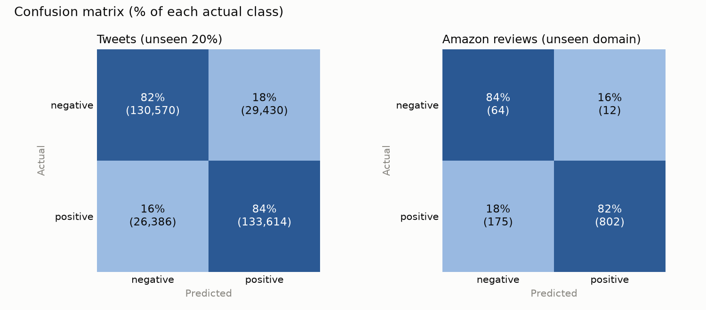
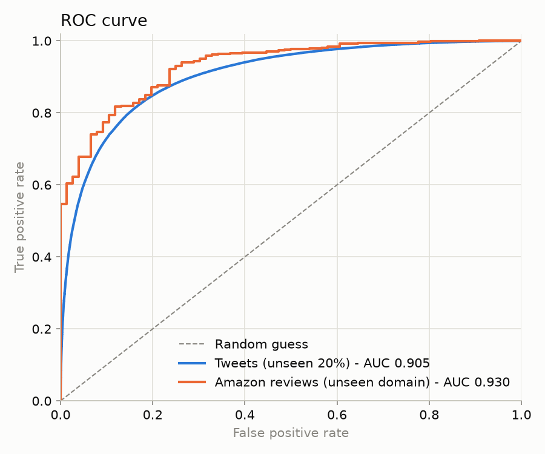

# Sentiment Analysis Web App

Type a sentence or a review and the app tells you whether it reads **positive**, **negative**, or **neutral**.
It's a small Flask app serving a scikit-learn model (TF-IDF + Logistic Regression) trained on 1.28 million tweets.

**Live demo:** https://veds-sentiment-analysis-app.onrender.com
(free hosting - the first request after a quiet period can take ~30-50 s while the server wakes up)

| | |
|---|---|
| Accuracy on unseen tweets | **82.6%** (320,000 tweets, ROC AUC 0.905) |
| Accuracy on Amazon product reviews (a kind of text it never trained on) | **82.2%** (1,053 reviews, ROC AUC 0.930) |
| Model file | 10 MB, one file |
| Stack | Python 3.11 · scikit-learn · Flask · gunicorn · Render |

---

## How it works

```
 your text
    │
    ▼
 clean_text()          lowercase, "&amp;" → "&", links → "url", @names → "user", "isn't" → "is not"
    │
    ▼
 TF-IDF vectorizer     turns text into 500,000 numbers: one per known word or word pair
    │                  ("not good" is its own feature, separate from "good")
    ▼
 Logistic Regression   weighs those numbers → probability the text is positive (0.0 - 1.0)
    │
    ▼
 label                 > 0.6 positive  ·  < 0.4 negative  ·  0.4 - 0.6 neutral
```

All three steps (cleaning, vectorizer, classifier) are saved together as **one scikit-learn `Pipeline`** in
`models/sentiment_pipeline.joblib`. The web app loads that one file, so it cleans and vectorizes text exactly the
way training did. It can't be done any other way, which removes the class of bug this project used to have (see [the learning log](#learning-log-mistakes-and-what-i-learned)).

**Why these choices**

- **TF-IDF** scores a word higher when it's frequent in this text but rare across all texts. "the" gets almost no weight;
  "awful" gets a lot.
- **Word pairs (bigrams)** are what let the model understand negation. With single words only, "not good" is just
  "not" + "good" and the model sees a positive word. With pairs, "not good" is learned as its own strongly negative feature.
- **Logistic Regression** is fast to train (~40 s on 1.28M tweets), tiny to serve, and gives a real probability,
  which is what makes the neutral band possible. Naive Bayes was tested too and scored ~2 points lower.
- **Neutral band:** the model was only ever trained on positive vs. negative, so when it's unsure (40-60%), the app says
  so instead of forcing a side. About 12% of texts land there.

## Data

| Dataset | Size | Used for |
|---|---|---|
| [Sentiment140](https://www.kaggle.com/datasets/kazanova/sentiment140) | 1.6M tweets from 2009, exactly 50% negative / 50% positive | 80% training, 20% testing |
| Amazon product reviews (`7817_1.csv`, Datafiniti format) | 1,053 reviews with a star rating (3★ dropped) - 977 positive, 76 negative | Testing only: does a tweet-trained model work on product reviews? |

Sentiment140 was labelled automatically by emoticons (`:)` → positive, `:(` → negative), so its labels are noisy.
That noise is a big reason simple models top out around 80-85% on it. Its raw labels are `0` and **`4`**, which
the code converts to 0/1 as soon as the data is loaded.
Download links and file formats: [data/README.md](data/README.md).

## Results

| Test set | Accuracy | ROC AUC | Negative recall | Positive recall |
|---|---|---|---|---|
| Tweets - unseen 20% (320,000) | 82.6% | 0.905 | 81.6% | 83.5% |
| Amazon reviews - unseen domain (1,053) | 82.2% | 0.930 | 84.2% | 82.1% |





**Before vs. after the rebuild**, measured on the same Amazon reviews:

| Version | Amazon accuracy | Positive reviews called negative |
|---|---|---|
| Live site before the fix (label bug) | **7.2%** | **100%**: it said "negative" for everything |
| Same old model, label bug fixed | 66.3% | 35.6% |
| Original notebook model (as an app would have served it) | 80.7% | 17.2% |
| **Current pipeline** | **82.2%** | **17.9%** |

The current pipeline is also the only one whose accuracy on tweets is measured honestly: on tweets it never saw
during training.

Raw numbers: [reports/metrics.json](reports/metrics.json).

## Project structure

```
app.py                  Flask web app (routes only - no ML code)
sentiment/
  config.py             paths, label meanings, split settings, neutral band - one source of truth
  data.py               loads both datasets, converts labels to 0/1, makes the fixed 80/20 split
  preprocess.py         clean_text(): the single cleaning function used by training AND the app
  train.py              builds + trains + saves the pipeline, then evaluates it
  evaluate.py           metrics.json + confusion matrix + ROC charts
  predict.py            loads the pipeline, returns positive / negative / neutral
models/                 sentiment_pipeline.joblib (the trained model)
reports/                metrics and charts used in this README
data/                   datasets go here (git-ignored; see data/README.md)
tests/                  pytest: cleaning rules, label mapping, model sanity, Flask routes
templates/, static/     HTML and CSS
requirements.txt        what the server needs (pinned versions)
requirements-dev.txt    + pandas, matplotlib, pytest for training and testing
```

## Run it locally

```bash
git clone https://github.com/VedPawar1410/sentiment-analysis-web-app.git
cd sentiment-analysis-web-app
python3.11 -m venv .venv && source .venv/bin/activate
pip install -r requirements.txt
python app.py                      # open http://127.0.0.1:5000
```

Or from the command line:

```bash
python -m sentiment.predict "not bad, actually pretty decent"
# positive  (positive probability = 0.94)
```

## Retrain and test

```bash
pip install -r requirements-dev.txt
# put the two CSVs in data/ (see data/README.md), then:
python -m sentiment.train          # ~1 min: trains, saves the model, writes reports/
python -m sentiment.evaluate       # re-score the saved model without retraining
python -m pytest                   # 15 tests
```

## Deployment

Hosted on Render as a Python web service, auto-deployed from `main`.

- Build command: `pip install -r requirements.txt`
- Start command: `gunicorn app:app`
- Python version: `.python-version` (3.11.9)

Versions are pinned because a saved scikit-learn model is tied to the version that created it.

## Limitations

- **Trained on tweets.** Words mean different things on Twitter: "battery", "phone" and "work" lean negative there
  (people tweet when their battery dies), so "The battery life is great" only scores 0.75 positive.
- **No real neutral class.** The neutral band is a confidence cut-off, not something the model learned. Text with no
  sentiment can still get a confident answer ("hello" scores 0.99 positive, because friendly greetings are common in
  positive tweets).
- **Doesn't understand sarcasm or context.** It's a weighted bag of words and word pairs.
- **The Amazon test set is small** (76 negative reviews), so its numbers can move a few points with a different sample.

---

## Learning log: mistakes and what I learned

This project was built in layers over two years. Each layer records what I did, what went wrong, and what I'd do
differently, so the full history of my thinking on this pipeline stays in one place.

### Layer 1 - The notebook (2024, Google Colab)

*What I built:* a Jupyter notebook that cleaned tweets (lowercase, remove symbols, remove stopwords, stem), vectorized them
with TF-IDF, and trained Logistic Regression (78.9%) and Naive Bayes (78%). I also tried a grid search over regularisation settings.

| # | Mistake | What actually happened | Lesson |
|---|---|---|---|
| 1.1 | **Didn't check that the whole dataset loaded** | `read_csv(engine='python', on_bad_lines='skip')` silently loaded 1,038,531 of 1.6M rows, and by the train/test split only ~497k rows (31%) were left. Nothing warned me. | After loading data, assert the row count and class balance you expect. "Skip bad lines" options hide data loss. |
| 1.2 | **Stopword removal deleted the word "not"** | NLTK's English stopword list includes "not", "no", "nor". "not good" became "good". | Generic NLP recipes can destroy the exact signal a task needs. For sentiment, negation words are signal, not noise. |
| 1.3 | **Training and prediction cleaned text differently** | The model learned from stemmed text ("amaz", "happi"), but an app sending raw text would not stem. Served that way, the notebook model dropped from 79% to 70% on tweets. | Package preprocessing *with* the model (a `Pipeline`), so prediction can't skip a step. This is called **training/serving skew**. |
| 1.4 | **Fixed a class imbalance that didn't exist** | I undersampled to balance classes, but Sentiment140 is already exactly 800k / 800k. The undersampling cell also used a variable (`X_vectorized`) that didn't exist, so it only worked because of hidden notebook state. | Look at the data before applying a technique. A notebook that only runs in one order isn't reproducible. |
| 1.5 | **Saved the wrong model** | The final `pickle.dump(model, ...)` saved the *untrained* `LogisticRegression()` object from the grid-search cell, not the trained `best_model`. | Save exactly the object you evaluated, then reload it and re-test it before shipping. |
| 1.6 | **Tuned hyperparameters on the test set, and it didn't help** | The best of 18 grid-search combinations scored 0.79, the same as the defaults. The limit was the features (single words, no negation), not the settings. The "test" set was also reused for every decision. | When tuning doesn't move the number, the bottleneck is usually the data or the features. Keep the test set untouched until the end. |
| 1.7 | **Small inconsistencies** | A comment said 80/20 while the code used 70/30; unused TensorFlow/PyTorch GPU checks were left in. | Small inconsistencies make a project hard to trust, for others and for future me. |

### Layer 2 - The web app and deployment (Nov 2025, Flask + Render)

*What I built:* a Flask app with a styled form and a result page, deployed on Render with gunicorn.

| # | Mistake | What actually happened | Lesson |
|---|---|---|---|
| 2.1 | **The label bug: every prediction was "negative"** | The app checked `prediction == 1`, but Sentiment140 marks positive as **4**. The check was never true, so the live site said "negative" for everything. I thought the model was "overfitted to negative", but the model was fine. | When output is *always* the same, suspect the plumbing before the model. Test the whole app end to end with obvious inputs ("I love this") before blaming training. |
| 2.2 | **Deployed a model with no training code** | `model1.pkl` was Naive Bayes on raw word counts, but the notebook trained Logistic Regression on TF-IDF, and the README described the latter. Nobody (including me) could rebuild what was live. | Every deployed model should come from a script you can rerun. The README must describe what's actually deployed. |
| 2.3 | **Commented out `if __name__ == "__main__"` for gunicorn** | I thought it would conflict with gunicorn. It doesn't: gunicorn imports `app` and never runs that block. Commenting it out only broke `python app.py` locally. | Understand *why* a production server works the way it does before changing code for it. |
| 2.4 | **Unpinned dependencies** | `requirements.txt` listed `scikit-learn` with no version. Any Render rebuild could install a newer version than the one that created the pickle. | Pin versions for anything that loads a saved model. |
| 2.5 | **Two loose pickle files (32 MB)** | Vectorizer and model were saved separately, so the app had to know how to glue them together. | One artifact per model. |
| 2.6 | **README drift** | The clone URL pointed at a repo name that didn't exist (`sentiment-analysis-app`). | Run your own README instructions once from scratch. |

### Layer 3 - The rebuild (Nov 2026)

*What I did:* fixed the label bug first (a one-line change), then replaced the notebook with a Python package
(`sentiment/`), trained a pipeline on the full dataset with an honest 80/20 split, added an out-of-domain test set
(Amazon reviews), a neutral band, pinned versions, and tests.

| # | Decision | Why |
|---|---|---|
| 3.1 | Fix the one-line bug *before* anything else | It explained the "negative bias" by itself; everything else was improvement, not repair. Ship the fix first, then refactor. |
| 3.2 | Convert labels to 0/1 at load time, defined once in `config.py` | The label bug came from two places having different ideas about what "positive" is. |
| 3.3 | No stopword removal, no stemming; add `n't → not` and word pairs | Directly fixes 1.2 and 1.3. Switching to this cleaning (mainly `n't → not`) added ~3.5 points on Amazon reviews over the same model without it. |
| 3.4 | Save one `Pipeline` with the cleaning function inside it | Fixes 1.3 and 2.5. The file went from 32 MB to 10 MB. |
| 3.5 | Evaluate on a second, different dataset | Accuracy on the same kind of data says little about real use. The Amazon test exposed the domain gap (the old model called 36% of positive reviews negative). |
| 3.6 | Report per-class recall, not just accuracy | On Amazon reviews (93% positive), a model that always says "positive" would score 93% accuracy and be useless. |
| 3.7 | A test that the model's classes are `[0, 1]` | So bug 2.1 can't come back silently. |

*Known gaps I chose not to fix (to keep the app small):* no hyperparameter tuning (it would need a separate
validation split, not the test set); no real neutral training data; tweet-only training vocabulary. Mixing in
product reviews (e.g. the Amazon Cell Phones reviews dataset) would be the next step for review-style text.

### Key takeaways

1. **Check the plumbing before the model.** The biggest "model problem" in this project was a label mapping bug in one line of app code.
2. **Training/serving skew is silent.** Ship preprocessing and model as one artifact.
3. **Measure on data the model hasn't seen, and on data unlike its training data.** Both told me different, useful things.
4. **Default NLP steps aren't free.** Stopword removal hurt; bigrams helped more than any hyperparameter.
5. **Reproducibility is a feature.** A script you can rerun beats a notebook cell you ran once.

---

## Future improvements

- Mix product reviews into training so review-style text scores better.
- Tune `C` and n-gram settings on a validation split.
- Show the confidence percentage on the result page.
